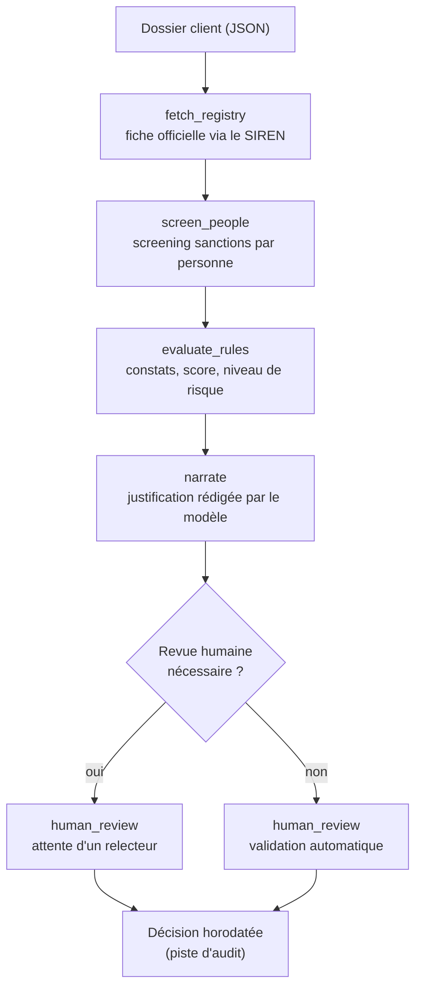
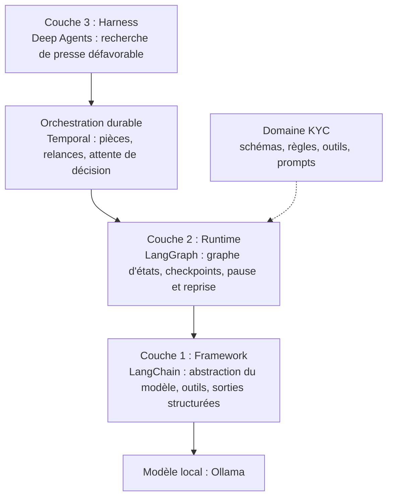
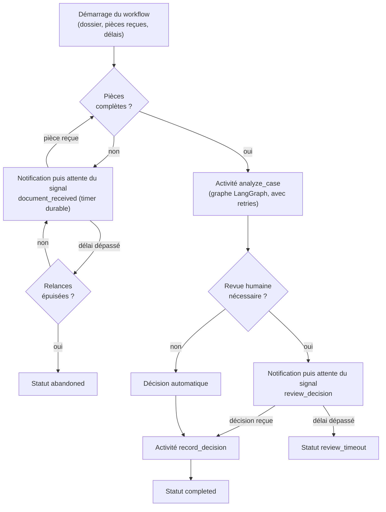
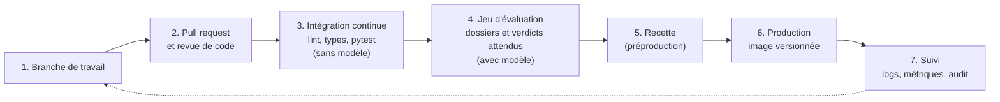
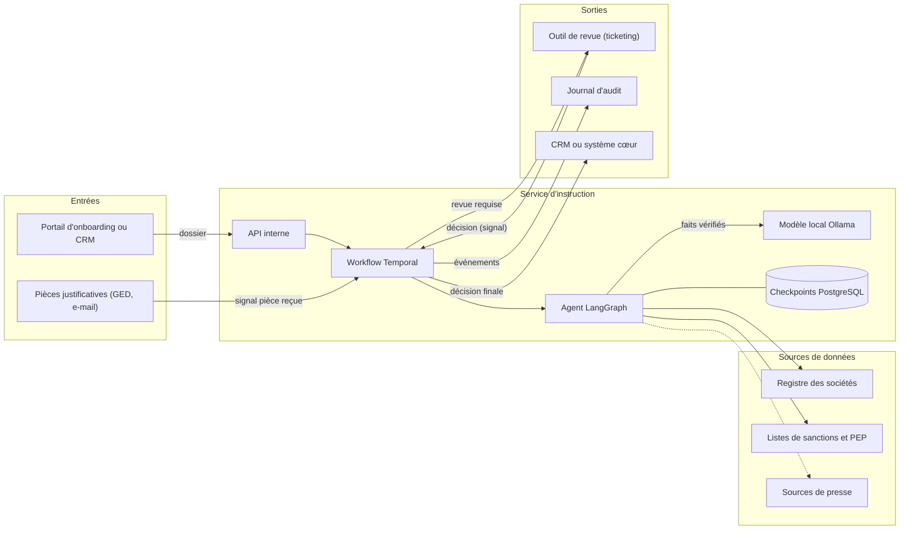

# due-diligence-agents : fonctionnement et intégration

Instruction automatisée de dossiers KYC/KYB. Fonctionnement, intégration au cycle de développement et aux outils de l'entreprise.

Version 1.1 - 11 octobre 2026

> Statut : projet d'ingénierie sur données synthétiques, non utilisable pour des décisions réelles. Les schémas de ce document sont écrits en Mermaid et s'affichent directement sur GitHub.

## Sommaire

1. [Résumé](#1-résumé)
2. [Le problème traité](#2-le-problème-traité)
3. [Principes de conception](#3-principes-de-conception)
4. [Fonctionnement](#4-fonctionnement)
5. [Architecture](#5-architecture)
6. [Le workflow durable (Temporal)](#6-le-workflow-durable-temporal)
7. [Intégration au cycle de développement](#7-intégration-au-cycle-de-développement)
8. [Intégration aux outils de l'entreprise](#8-intégration-aux-outils-de-lentreprise)
9. [Sécurité, conformité et gouvernance](#9-sécurité-conformité-et-gouvernance)
10. [Limites connues et feuille de route](#10-limites-connues-et-feuille-de-route)
11. [Annexe A : organisation du dépôt](#annexe-a--organisation-du-dépôt)
12. [Annexe B : commandes utiles](#annexe-b--commandes-utiles)
13. [Annexe C : glossaire](#annexe-c--glossaire)

## 1. Résumé

Ce projet instruit automatiquement un dossier d'entrée en relation. Il vérifie que les pièces requises sont présentes, récupère la fiche officielle de la société, vérifie les personnes concernées contre une liste de sanctions, compare les informations déclarées aux informations officielles, calcule un score de risque, puis rédige une justification. Lorsque le dossier est risqué ou ambigu, il attend la décision d'un relecteur humain, parfois pendant plusieurs jours.

Le choix structurant est le suivant : **tout ce qui peut être décidé par une règle l'est par du code Python, et le modèle de langage ne fait que rédiger l'explication**. Deux dossiers identiques donnent donc les mêmes constats et le même score. L'ensemble tourne en local avec Ollama, de sorte que les données d'un dossier ne quittent pas l'infrastructure.

Le système repose sur deux niveaux de durabilité complémentaires :

- **LangGraph** sauvegarde l'état de l'analyse après chaque étape (échelle de quelques minutes).
- **Temporal** pilote le dossier de bout en bout : attente de pièces, relances, attente d'une décision humaine, reprise après arrêt (échelle de plusieurs jours).

Ce document présente le fonctionnement, l'architecture, l'intégration au cycle de développement et aux outils de l'entreprise. Les outils cités en section 8 sont des exemples courants, à adapter à l'environnement réel. Les sigles sont expliqués dans le [glossaire](#annexe-c--glossaire).

## 2. Le problème traité

Avant d'accepter un client, une entreprise réglementée doit répondre à quelques questions : la société existe-t-elle, les informations fournies correspondent-elles au registre officiel, qui en sont les dirigeants et les bénéficiaires effectifs, et l'une de ces personnes figure-t-elle sur une liste de sanctions ? Cette instruction est répétitive, soumise à des règles précises, et doit laisser une trace démontrable.

Un agent qui laisserait un modèle de langage mener seul cette instruction poserait trois problèmes : des résultats qui varient d'un essai à l'autre, des données recopiées de travers, et une impossibilité d'expliquer pourquoi un score vaut 85 plutôt que 40. Les essais menés sur une première version (un agent à outils sans orchestration, conservée dans `baseline.py`) ont montré ces trois défauts, ce qui a motivé l'architecture décrite ici.

| Point observé                       | Baseline (modèle seul)                                          | Version actuelle                             |
| :---------------------------------- | :-------------------------------------------------------------- | :------------------------------------------- |
| Score                               | choisi par le modèle, sans règle                                | calculé par des règles explicites            |
| Cohérence score et niveau de risque | non garantie (score 0 avec risque élevé observé)                | garantie par le code                         |
| Fidélité des données                | le modèle recopie les adresses (codes postaux altérés observés) | valeurs issues directement des sources       |
| Appels d'outils                     | doublons observés                                               | un screening par personne distincte          |
| Reprise après panne                 | aucune, tout recommence                                         | reprise au nœud interrompu                   |
| Ce qui varie d'un essai à l'autre   | tout                                                            | seulement la formulation de la justification |

## 3. Principes de conception

1. **Les contrôles déterministes sont du code.** Consultation du registre, screening, détection d'écarts, score et décision d'escalade sont des fonctions Python testées. Le modèle ne peut ni modifier une adresse, ni choisir un score.
2. **Le modèle ne rédige que la justification**, et il ne reçoit que des informations déjà vérifiées, réduites à la catégorie et à la gravité de chaque constat. Il n'a donc aucune valeur brute à recopier.
3. **Chaque étape est sauvegardée.** Le dossier est un graphe d'états dont l'état est enregistré après chaque nœud. Un arrêt brutal ne force pas à tout recommencer.
4. **L'humain tranche les cas à risque.** L'attente est durable : elle survit à l'arrêt du processus, voire de la machine.
5. **Les opérations vers l'extérieur sont idempotentes.** Les rejouer (après un échec, par exemple) ne produit pas de doublon.
6. **Tout est local par défaut.** Le modèle tourne via Ollama sur l'infrastructure de l'entreprise.

## 4. Fonctionnement

### 4.1 Le parcours d'une analyse



Les trois premiers nœuds sont du code Python pur. Seul `narrate` appelle le modèle. L'état est sauvegardé après chaque nœud.

| Étape            | Ce qui se passe                                                                                                                                                                                              |
| :--------------- | :----------------------------------------------------------------------------------------------------------------------------------------------------------------------------------------------------------- |
| `fetch_registry` | Lit la fiche officielle de la société à partir du SIREN. Si le SIREN est inconnu, la fiche contient une erreur, traitée comme un constat grave.                                                              |
| `screen_people`  | Dresse la liste des personnes distinctes (dirigeants et bénéficiaires effectifs) et vérifie chacune contre la liste de sanctions. Une personne présente deux fois n'est vérifiée qu'une fois.                |
| `evaluate_rules` | Compare les données déclarées à la fiche officielle, produit les constats, calcule le score et le niveau de risque, décide si une revue humaine est nécessaire.                                              |
| `narrate`        | Transmet au modèle la liste des contrôles effectués, les constats (catégorie et gravité seulement), le score et le niveau de risque, et lui demande une justification de trois à quatre phrases en français. |
| `human_review`   | Si le risque est faible, approuve automatiquement. Sinon, interrompt l'exécution et attend la décision (approuvé ou rejeté), enregistrée avec le nom du relecteur, un commentaire et l'horodatage.           |

### 4.2 Comment le graphe s'exécute

- `add_node` **déclare** un poste de travail (un nom et une fonction). Il n'exécute rien, et l'ordre des déclarations n'a aucune importance.
- `add_edge` **déclare** l'enchaînement : c'est lui qui détermine l'ordre d'exécution.
- Un nœud n'appelle jamais le suivant. Il lit l'état, renvoie sa contribution, et rend la main : c'est le moteur qui choisit ensuite le prochain nœud et sauvegarde le checkpoint. C'est ce qui rend possibles la pause, la reprise et le parallélisme.
- Le parallélisme apparaît quand un nœud a **plusieurs flèches sortantes** : les nœuds prêts au même moment s'exécutent ensemble, et `add_edge([a, b], "c")` attend que `a` et `b` soient tous deux terminés. Deux nœuds parallèles ne doivent pas écrire dans la même clé de l'état, sauf si cette clé déclare une règle de fusion (reducer).
- Une **arête conditionnelle** (`add_conditional_edges`) permet de choisir le prochain nœud à l'exécution, à partir de l'état.

### 4.3 Les règles de scoring

Les règles sont regroupées dans un seul module, `src/kyc/domain/scoring.py`, lisible par un non-développeur et testable sans modèle. Les valeurs actuelles sont des exemples de démonstration, destinées à être fixées avec la conformité.

| Règle                                                  | Effet sur le score | Gravité du constat |
| :----------------------------------------------------- | :----------------- | :----------------- |
| Une personne figure sur la liste de sanctions          | Plancher à 90      | Élevée             |
| SIREN introuvable au registre                          | + 50               | Élevée             |
| Adresse du siège différente de la fiche officielle     | + 30               | Moyenne            |
| Dirigeant déclaré absent de la fiche officielle        | + 25               | Moyenne            |
| Parts des bénéficiaires effectifs différentes de 100 % | + 20               | Moyenne            |

Le score est plafonné à 100. Un score d'au moins 70 donne un risque élevé, d'au moins 30 un risque moyen, sinon faible. **Tout risque non faible déclenche une revue humaine.** Une sanction confirmée impose un score d'au moins 90, quels que soient les autres constats.

### 4.4 La règle de complétude

Avant l'analyse, le workflow vérifie que les pièces requises ont été reçues (`src/kyc/domain/completeness.py`).

| Pièce requise                   | Identifiant      |
| :------------------------------ | :--------------- |
| Extrait Kbis                    | `kbis`           |
| Statuts de la société           | `statuts`        |
| Pièce d'identité des dirigeants | `piece_identite` |

La vérification porte sur la **réception déclarée** des pièces (leur nom), pas sur leur contenu. Les pièces reçues sont un paramètre du workflow, pas un champ du dossier.

### 4.5 Exemple de bout en bout

Le dossier de démonstration déclare une adresse à Marseille alors que le registre indique Paris, et compte parmi ses bénéficiaires effectifs une personne présente sur la liste de sanctions (40 % des parts). Le système produit un score de 90, un risque élevé, deux constats (sanction, incohérence d'adresse) et une demande de revue humaine. Le relecteur consulte le dossier, puis rejette avec le commentaire « Sanction confirmée ». La décision est enregistrée avec son horodatage.

Un second dossier, cohérent avec le registre et sans sanction, obtient un score de 0 et une approbation automatique.

### 4.6 Reprise après panne et pause durable

L'état de l'analyse est écrit dans une base après chaque nœud. Deux situations utilisent ce même mécanisme :

- **Panne** : si le processus s'arrête pendant la rédaction, la relance avec le même identifiant ne rejoue que la rédaction. Le registre, le screening et le scoring ne sont pas refaits. Cela a été vérifié par un test de panne volontaire (`KYC_FAIL_AT=narrate`).
- **Pause** : lorsque le dossier attend un relecteur, le processus se termine. Le relecteur peut décider plusieurs heures ou jours plus tard avec une commande distincte, et l'exécution reprend uniquement à l'étape de revue.

Le fonctionnement de la pause (`interrupt`) mérite d'être connu :

1. `interrupt(...)` arrête le nœud, le checkpoint est écrit avec la marque "en attente de réponse", et le processus se termine.
2. À la reprise (`Command(resume=...)`), le nœud `human_review` est **réexécuté depuis sa première ligne**, et `interrupt(...)` renvoie cette fois la réponse fournie.
3. Conséquence : tout ce qui précède `interrupt` dans un même nœud s'exécute deux fois. Les actions irréversibles (envoi d'e-mail, écriture externe) doivent donc être placées dans un nœud situé après la revue.

Le drapeau `requires_human_review` n'arrête rien en lui-même : il est calculé par les règles et stocké dans l'état. C'est le nœud `human_review` qui décide de s'interrompre selon sa valeur.

## 5. Architecture



| Couche                | Outil            | Rôle dans le projet                                                                                                           |
| :-------------------- | :--------------- | :---------------------------------------------------------------------------------------------------------------------------- |
| Framework             | LangChain        | Abstraction du modèle, définition des outils, sorties structurées validées par un schéma.                                     |
| Runtime               | LangGraph        | Graphe d'états, sauvegarde après chaque nœud, pause et reprise.                                                               |
| Orchestration durable | Temporal         | Un workflow par dossier : attente de pièces, relances, attente de la décision humaine, retries.                               |
| Harness               | Deep Agents      | Recherche ouverte de presse défavorable, avec planification et sous-agents. Appelée comme un outil par l'agent d'instruction. |
| Domaine               | Python, Pydantic | Schémas, règles de scoring, règle de complétude, outils, prompts. Seule partie propre au KYC.                                 |

### 5.1 Partage des rôles entre LangGraph et Temporal

|                  | LangGraph                       | Temporal                                          |
| :--------------- | :------------------------------ | :------------------------------------------------ |
| Échelle de temps | Une analyse de quelques minutes | Un dossier sur plusieurs jours                    |
| Reprise          | Au dernier nœud réussi          | Après arrêt du worker, avec relances automatiques |
| Attente          | Pause `interrupt`               | Timers durables et signaux                        |
| Utilisation ici  | Les contrôles et la rédaction   | Le processus métier autour                        |

Le graphe existe en deux variantes, paramétrées par `with_review` : avec revue humaine intégrée (utilisation autonome, via `review.py`), et sans revue (utilisation par le workflow, qui gère l'attente lui-même). Cette double voie de revue est un compromis assumé, à documenter pour les relecteurs du code.

### 5.2 Plusieurs agents qui communiquent

Les échanges entre agents sont volontairement structurés : l'agent d'instruction confie une sous-tâche à l'agent de recherche en lui passant un sujet (nom, société), et reçoit en retour un objet typé (signaux, sources, niveau de confiance). Ce n'est pas un dialogue libre, car en conformité les échanges doivent rester contrôlables et traçables. Un agent relecteur de qualité, chargé de signaler les incohérences avant la validation humaine, est envisagé une fois le jeu d'évaluation en place.

### 5.3 Réutilisation pour d'autres usages

La séparation entre le domaine et le reste permet la réutilisation : changer de cas d'usage (analyse de contrats, instruction de sinistres, demandes de crédit, conformité fournisseurs, traçabilité des pierres en joaillerie) doit se limiter à remplacer les schémas, les règles, les outils et les prompts. Le graphe, la pause, le workflow durable, la piste d'audit et le jeu d'évaluation sont génériques. Un test à faire en fin de projet : changer de domaine en ne modifiant que `domain/` et `tools/`.

## 6. Le workflow durable (Temporal)

### 6.1 Déroulé



### 6.2 Les éléments du workflow

| Élément                       | Rôle                                                                                                                                       |
| :---------------------------- | :----------------------------------------------------------------------------------------------------------------------------------------- |
| Workflow `CaseReviewWorkflow` | Orchestre le dossier. Son code est rejoué depuis l'historique après un arrêt, il doit donc être déterministe.                              |
| Activités                     | Opérations qui touchent l'extérieur : analyse (modèle), notifications, enregistrement de la décision. Temporal les relance en cas d'échec. |
| Signal `document_received`    | Message reçu de l'extérieur : une pièce est arrivée.                                                                                       |
| Signal `review_decision`      | Message reçu de l'extérieur : la décision du relecteur.                                                                                    |
| Requête `status`              | Lecture de l'état courant du dossier (`waiting_documents`, `analyzing`, `waiting_review`, `completed`...).                                 |
| Worker                        | Processus qui exécute workflows et activités. Le serveur Temporal stocke l'historique et pilote les timers, mais n'exécute pas le code.    |

Paramètres d'un dossier (`CaseInput`) : le dossier, les pièces déjà reçues, le délai d'attente des pièces (2 jours par défaut), le délai d'attente de la décision (5 jours par défaut) et le nombre de relances (3 par défaut).

### 6.3 Statuts de fin

| Statut           | Signification                                  |
| :--------------- | :--------------------------------------------- |
| `completed`      | Analyse terminée et décision enregistrée.      |
| `abandoned`      | Pièces toujours manquantes après les relances. |
| `review_timeout` | Aucune décision humaine dans le délai imparti. |

### 6.4 Règles à respecter

- **Déterminisme du workflow.** Pas de `datetime.now()`, de hasard, de réseau ni de fichier dans le code du workflow : on utilise `workflow.now()`, et tout le reste va dans des activités.
- **Idempotence des activités.** `analyze_case` reprend au checkpoint LangGraph si l'analyse existe déjà pour cet identifiant, ou renvoie le résultat déjà calculé. `record_decision` écrit un fichier par dossier, qu'on peut réécrire sans doublon.
- **Identifiant de dossier unique.** L'identifiant du workflow sert aussi d'identifiant d'analyse (thread). Il doit être unique par dossier, comme un numéro de dossier métier.
- **Politique de retry.** L'analyse est retentée avec des délais croissants (5 s, puis jusqu'à 60 s, 8 tentatives au plus).

### 6.5 Les deux niveaux de durabilité en pratique

Une panne du modèle pendant la rédaction illustre leur complémentarité : Temporal relance l'activité d'analyse avec des délais croissants, et LangGraph, au lieu de tout refaire, reprend au nœud `narrate` à partir du dernier checkpoint. Un arrêt du worker pendant l'attente de la décision ne perd rien non plus : à son retour, Temporal rejoue l'historique et le dossier reste en attente.

## 7. Intégration au cycle de développement

### 7.1 Du poste du développeur à la production



Les cas réels difficiles rencontrés en production alimentent le jeu d'évaluation.

### 7.2 Deux natures de tests

|                     | Tests déterministes                                                                          | Jeu d'évaluation avec modèle                                                          |
| :------------------ | :------------------------------------------------------------------------------------------- | :------------------------------------------------------------------------------------ |
| Ce qu'ils vérifient | Règles de scoring, règle de complétude, pause et reprise du graphe, comportement du workflow | Qualité de bout en bout : détection des sanctions, stabilité, taux d'escalade, durée  |
| Besoin du modèle    | Non                                                                                          | Oui                                                                                   |
| Durée               | Quelques secondes                                                                            | Plusieurs minutes                                                                     |
| Quand les lancer    | À chaque commit, bloquants                                                                   | Sur chaque pull request touchant les prompts, le modèle ou les règles, et chaque nuit |
| Règle de décision   | Tout doit passer                                                                             | Aucune régression par rapport à la référence précédente                               |

Les tests du workflow utilisent le serveur de test de Temporal, qui **saute le temps** : un délai de deux jours s'exécute instantanément, et les activités sont remplacées par des doublures (aucun modèle n'est appelé). Le premier lancement télécharge un binaire, ce qui demande un accès réseau.

### 7.3 Ce qui est versionné, et comment

- **Le code et les règles de scoring** : dans git, avec revue obligatoire. Le fichier des règles devrait être relu par un représentant de la conformité (fichier CODEOWNERS), car modifier un seuil modifie la politique de risque.
- **Les prompts** : traités comme du code, dans le dépôt et revus de la même façon.
- **Le modèle** : sa version est épinglée et configurée par variable d'environnement (`KYC_MODEL`). Changer de modèle est un changement à part entière, qui passe par le jeu d'évaluation.
- **Les dépendances** : verrouillées dans `uv.lock`, pour qu'un environnement se recrée à l'identique.
- **Les jalons** : un tag git par étape d'architecture (`baseline`, `deterministic-scoring`, `human-review`, `durable-workflow`...), utile pour comparer deux versions sur le même dossier.

### 7.4 Environnements

| Environnement     | Composition                                                                                          | Usage                                                    |
| :---------------- | :--------------------------------------------------------------------------------------------------- | :------------------------------------------------------- |
| Poste développeur | Ollama local, SQLite, serveur Temporal de développement (Docker), modèle léger, données synthétiques | Développement et tests unitaires                         |
| Recette           | Conteneurs : service, PostgreSQL, Temporal avec persistance, Ollama sur machine dédiée               | Jeu d'évaluation complet, essais avec les équipes métier |
| Production        | Mêmes conteneurs, secrets gérés par un coffre, sauvegardes, supervision                              | Instruction réelle, sous responsabilité de la conformité |

### 7.5 Critères de fin de chantier pour une évolution

- Les tests déterministes passent, sans modification des attentes sauf décision documentée.
- Le jeu d'évaluation ne montre aucune régression, ou la régression est expliquée et acceptée.
- Toute modification de règle est validée par la conformité.
- Le journal d'audit reste complet : chaque décision garde son auteur, son horodatage et son commentaire.
- La documentation (README, ce document) est à jour.

## 8. Intégration aux outils de l'entreprise

### 8.1 Flux d'information



Le dossier arrive depuis le portail d'onboarding ou le CRM par une API interne. Le workflow pilote le dossier : il reçoit les pièces au fil de l'eau sous forme de signaux, appelle l'agent d'instruction, notifie l'outil de revue quand une décision humaine est nécessaire, puis publie la décision finale vers le système cœur et les événements vers le journal d'audit.

### 8.2 Points de raccordement

| Besoin                    | Outils types                                                          | Point d'intégration                                                                                       |
| :------------------------ | :-------------------------------------------------------------------- | :-------------------------------------------------------------------------------------------------------- |
| Code et revue             | GitHub ou GitLab                                                      | Pull requests, règles de relecture par domaine (conformité sur les règles de scoring)                     |
| Intégration continue      | GitHub Actions, GitLab CI                                             | Lint, vérification des types, tests déterministes, puis job d'évaluation avec modèle                      |
| Conteneurs et déploiement | Docker, Kubernetes ou machines virtuelles                             | Image versionnée du service et du worker, déploiement par environnement                                   |
| Secrets                   | Coffre de secrets de l'entreprise                                     | Accès aux API de registre et de sanctions, sans clé dans le dépôt                                         |
| État des analyses         | PostgreSQL                                                            | Remplace SQLite pour les checkpoints, sauvegardé comme les autres bases                                   |
| Orchestration             | Temporal (auto-hébergé ou service géré)                               | Un workflow par dossier, signaux pour les pièces reçues et les décisions                                  |
| Revue humaine             | Outil de tickets (Jira, ServiceNow) ou interface interne              | Un ticket est créé quand le dossier attend une décision, la décision revient sous forme de signal par API |
| Notifications             | E-mail, messagerie interne                                            | Remplacent les notifications de démonstration (activités `notify_*`)                                      |
| Entrées                   | Portail d'onboarding, CRM, GED                                        | API interne de création de dossier, signal à la réception d'une pièce                                     |
| Sources de données        | Registre officiel, fournisseur de sanctions et PEP, sources de presse | Remplacent les fichiers JSON de démonstration, derrière les mêmes interfaces d'outils                     |
| Audit et supervision      | SIEM, outils de métriques                                             | Événements de décision archivés, métriques de durée par étape, d'escalade et d'échec                      |
| Modèle                    | Ollama sur serveur interne, avec GPU si possible                      | Variable d'environnement du modèle, version épinglée                                                      |

### 8.3 De la démonstration au service

| Aujourd'hui                                               | Cible                                              | Pourquoi                                                    |
| :-------------------------------------------------------- | :------------------------------------------------- | :---------------------------------------------------------- |
| Base SQLite locale                                        | PostgreSQL                                         | Accès concurrent, sauvegarde, exploitation                  |
| Serveur Temporal de développement (historique en mémoire) | Temporal avec persistance                          | Ne pas perdre les dossiers en cours si le serveur redémarre |
| Revue par ligne de commande (signal)                      | Ticket ou interface avec authentification          | Identifier le relecteur de façon fiable, séparer les rôles  |
| Notifications affichées dans le terminal                  | E-mail, ticket                                     | Prévenir réellement le client et le relecteur               |
| Fichiers JSON de démonstration                            | API de registre et de sanctions                    | Données réelles et à jour                                   |
| Correspondance exacte des noms                            | Correspondance approchée, alias, translittérations | Les listes réelles contiennent des variantes d'écriture     |
| Complétude par nom de pièce                               | Vérification du contenu des pièces                 | Une pièce déclarée reçue peut être vide ou erronée          |
| Modèle léger local                                        | Modèle validé sur le jeu d'évaluation              | Qualité de la justification                                 |

## 9. Sécurité, conformité et gouvernance

- **Données** : le modèle est local, donc aucune donnée de dossier n'est envoyée à un fournisseur externe. Les fichiers de checkpoints et le journal d'audit contiennent des données personnelles : ils doivent être protégés, chiffrés et soumis à une durée de conservation.
- **Traçabilité** : chaque décision porte son auteur, son commentaire et son horodatage. L'historique du workflow Temporal et celui des checkpoints permettent de reconstituer le raisonnement du système étape par étape.
- **Séparation des rôles** : les règles de scoring sont définies par la conformité et appliquées par le code. Le développeur ne devrait pas pouvoir les modifier sans validation.
- **Rôle du modèle** : il ne prend aucune décision. Son texte est une aide à la lecture, et le relecteur voit toujours les constats issus du code à côté.
- **Cadre réglementaire** : le projet n'implémente aucune exigence réglementaire à ce stade. Toute mise en production suppose une validation par la conformité et le juridique.

## 10. Limites connues et feuille de route

### 10.1 Limites

- **Altération de données par le modèle** : dans les premiers essais, le modèle a recopié de travers des adresses dans sa justification (codes postaux altérés). Le correctif consiste à ne lui transmettre que la catégorie et la gravité des constats. Il reste prudent de contrôler automatiquement le texte généré (par exemple refuser une justification contenant des valeurs absentes des constats).
- **Affirmations excessives** : sur un dossier sain, la justification pouvait conclure à l'absence d'activité suspecte, ce qui dépasse ce que les contrôles vérifient. Le modèle reçoit désormais la liste des contrôles effectués et la consigne de s'y limiter.
- **Consignes non toujours respectées** : un petit modèle local suit imparfaitement les instructions de format et de contenu, ce qui justifie de lui retirer toute décision.
- **Pas d'extraction de documents** : les dossiers sont déjà structurés (JSON). La lecture automatique de pièces (Kbis, statuts, pièces d'identité) n'est pas implémentée, et la complétude ne vérifie que la réception déclarée.
- **Double voie de revue** : la revue existe sous deux formes (pause LangGraph en autonome, signal Temporal dans le workflow), ce qui duplique une partie de la logique.
- **Données de démonstration** : registre et sanctions sont de petits fichiers synthétiques.

### 10.2 Feuille de route

| Étape | Contenu                                                                           | Résultat attendu                                                    | Statut                                        |
| :---- | :-------------------------------------------------------------------------------- | :------------------------------------------------------------------ | :-------------------------------------------- |
| 1     | Agent à outils sans orchestration                                                 | Référence de comparaison                                            | Réalisé                                       |
| 2     | Graphe d'états, scoring déterministe, justification contrainte                    | Reprise après panne, résultats reproductibles                       | Réalisé                                       |
| 3     | Validation humaine par pause                                                      | Piste d'audit des décisions                                         | Réalisé                                       |
| 4     | Workflow durable Temporal (pièces, relances, signaux, retries)                    | Attente sur plusieurs jours, reprise après arrêt                    | Code livré, validation par scénarios en cours |
| 5     | Recherche de presse défavorable (Deep Agents), exécutée en parallèle du screening | Signaux supplémentaires, sources citées                             | Prévu                                         |
| 6     | Jeu d'évaluation et agent relecteur                                               | Mesure objective, détection d'incohérences avant validation humaine | Prévu                                         |

## Annexe A : organisation du dépôt

```
data/                           registre, liste de sanctions et dossiers synthétiques
docker-compose.yml              serveur Temporal de développement
src/kyc/
  domain/
    schemas.py                  modèles Pydantic (constats, évaluation, décision)
    scoring.py                  règles de scoring et niveau de risque
    completeness.py             règle de complétude des pièces
    prompts.py                  consigne de rédaction de la justification
  tools/
    registry.py                 consultation du registre des sociétés
    sanctions.py                screening sanctions
  agent/
    baseline.py                 agent à outils sans orchestration (référence, inchangé)
    graph.py                    graphe LangGraph, avec ou sans revue intégrée
    review.py                   outil du relecteur en ligne de commande (mode autonome)
    adverse_media.py            recherche de presse (prévu)
  workflows/
    case_review.py              workflow Temporal
    activities.py               activités (analyse, notifications, enregistrement)
    worker.py                   processus worker
  cli.py                        démarrer, suivre et décider un dossier via Temporal
tests/                          scoring, complétude, flux de revue, workflow
.checkpoints/                   checkpoints SQLite (ignoré par git)
.audit/                         décisions finales par dossier (ignoré par git)
```

## Annexe B : commandes utiles

### Mode autonome (graphe seul)

| Action                          | Commande                                                                                 |
| :------------------------------ | :--------------------------------------------------------------------------------------- |
| Lancer un dossier               | `uv run python -m kyc.agent.graph data/dossiers/dossier_001.json run-1`                  |
| Lister les dossiers en attente  | `uv run python -m kyc.agent.review pending`                                              |
| Consulter un dossier en attente | `uv run python -m kyc.agent.review show run-1`                                           |
| Décider                         | `uv run python -m kyc.agent.review decide run-1 rejected --reviewer nom --comment "..."` |
| Simuler une panne               | `KYC_FAIL_AT=narrate uv run python -m kyc.agent.graph ...`                               |
| Changer de modèle               | `KYC_MODEL=qwen3:8b uv run python -m kyc.agent.graph ...`                                |

### Mode workflow (Temporal)

| Action                               | Commande                                                                                                    |
| :----------------------------------- | :---------------------------------------------------------------------------------------------------------- |
| Démarrer le serveur de développement | `docker compose up -d` (interface web sur le port 8233)                                                     |
| Démarrer le worker                   | `uv run python -m kyc.workflows.worker`                                                                     |
| Démarrer un dossier                  | `uv run python -m kyc.cli start data/dossiers/dossier_001.json case-1 --pieces kbis statuts piece_identite` |
| Consulter l'état                     | `uv run python -m kyc.cli status case-1`                                                                    |
| Signaler une pièce reçue             | `uv run python -m kyc.cli document case-1 statuts`                                                          |
| Décider                              | `uv run python -m kyc.cli decide case-1 rejected --reviewer nom --comment "..."`                            |
| Obtenir le résultat                  | `uv run python -m kyc.cli result case-1`                                                                    |

### Tests

| Action                | Commande        |
| :-------------------- | :-------------- |
| Lancer tous les tests | `uv run pytest` |

## Annexe C : glossaire

| Sigle ou terme | Signification                                                                                                                         |
| :------------- | :------------------------------------------------------------------------------------------------------------------------------------ |
| KYC            | Know Your Customer : vérification d'un client personne physique                                                                       |
| KYB            | Know Your Business : vérification d'une entreprise cliente                                                                            |
| SIREN          | Identifiant à neuf chiffres d'une société française                                                                                   |
| PEP            | Personne Politiquement Exposée : personne exerçant ou ayant exercé une fonction publique importante, imposant une vigilance renforcée |
| LLM            | Large Language Model : modèle de langage                                                                                              |
| CRM            | Customer Relationship Management : gestion de la relation client                                                                      |
| GED            | Gestion Électronique de Documents                                                                                                     |
| SIEM           | Security Information and Event Management : outil de collecte et d'analyse des événements de sécurité                                 |
| Checkpoint     | Sauvegarde de l'état d'une analyse après un nœud                                                                                      |
| Signal         | Message envoyé de l'extérieur à un workflow en cours                                                                                  |
| Activité       | Opération d'un workflow qui touche l'extérieur (modèle, notification, écriture), relancée en cas d'échec                              |
| Idempotent     | Se dit d'une opération qu'on peut rejouer sans changer le résultat                                                                    |
| Déterministe   | Se dit d'un code qui donne toujours le même résultat pour les mêmes entrées                                                           |
| Reducer        | Règle de fusion appliquée quand plusieurs nœuds parallèles écrivent dans la même clé de l'état                                        |
